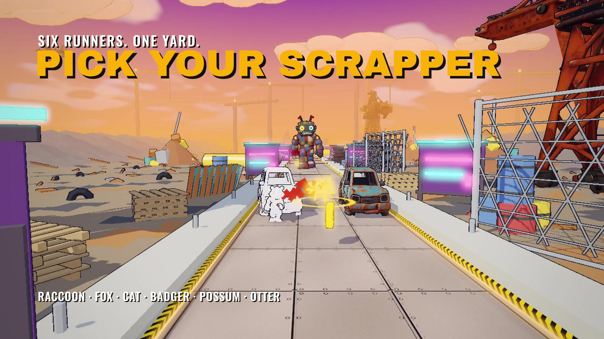
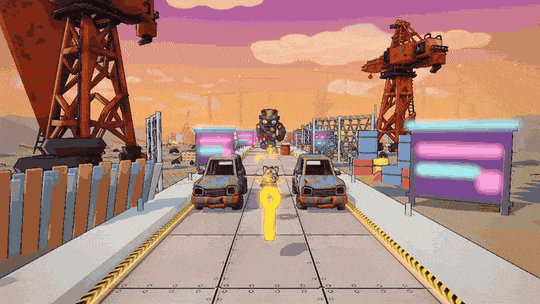
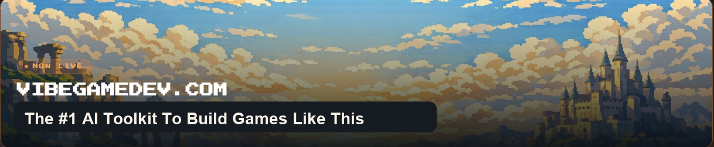

<div align="center">



# Scrappy Yard

### A raccoon vs a junk mech, in a scrapyard that wants you flattened.

A browser runner directed in chat and built with **Grok Bot**. This `public` branch is a sanitized snapshot of the source, the lessons, and the trailers — safe to share.

<br>

[](https://www.vibegamedev.com/?utm_source=github&utm_medium=readme_badge&utm_campaign=scrappy-yard)

[**▶ Play on Wavedash**](https://wavedash.com/games/scrappy-yard) &nbsp;·&nbsp;
[**Play in your browser**](https://scrappy-yard.vercel.app) &nbsp;·&nbsp;
[**Read the lessons**](share/master.html)




</div>

---

## The game

You play a raccoon in goggles sprinting through a neon scrapyard while a patchwork junk mech stomps after you. Dodge barrels, scrap cars and gaps, grab hex nuts, and survive the chase. Extra playable skins — fox, cat, badger, possum and otter — sit alongside the raccoon.

- **A scrapyard runner.** Lanes, hazards, pickups and a mech that closes the distance if you hesitate.
- **Built for the browser.** Play on [Wavedash](https://wavedash.com/games/scrappy-yard) or directly at [scrappy-yard.vercel.app](https://scrappy-yard.vercel.app).
- **No off-the-shelf game engine.** A fixed-step simulation in Rust compiled to WebAssembly, with a renderer that talks to WebGPU and falls back to WebGL 2.

## Run it

You need Node.js 22.4+, Rust (the pinned toolchain adds the `wasm32-unknown-unknown` target on first build) and a recent Chrome.

```sh
npm ci
npm run dev                  # the game at http://localhost:5173
npm test                     # Rust tests
npm run test:game            # TypeScript tests against the built simulation
npm run smoke                # the packaged build in headless Chrome
```

The models, audio and UI art the game ships are in [`game/public/assets`](game/public/assets). The Blender sources they were built from are not in this snapshot, only the scripts that rebuilt and checked them ([`assets/scripts`](assets/scripts)).

## What's here

| Path | What it is |
| --- | --- |
| [`game/`](game) | Scrappy Yard itself: the TypeScript game (`src/`), its Rust simulation (`crate/`), runtime assets (`public/`), docs and tests |
| [`src/`](src), [`crates/engine/`](crates/engine) | The game-neutral engine: renderer, glTF loading, audio, input, menus, platform adapters. It reaches the game only through the `@game` alias |
| [`share/master.html`](share/master.html) | The lessons: how the game was directed and built, with clips, screenshots and the gameplay and process trailers. Open it in a browser |
| [`docs/direction/`](docs/direction) | Design notes and directions explored while making the game |
| [`convex/`](convex) | Backend functions for the leaderboard and in-app purchases (secrets stay in Convex env, not in this tree) |
| [`tests/`](tests), [`scripts/`](scripts), [`deploy/`](deploy) | Engine tests, build and packaging scripts, and release rules |

This branch does **not** include the private VibeGameDev member skills pack or Blender source files.

## Read it in this order

1. [`share/master.html`](share/master.html): the lessons, trailers and build notes
2. [`docs/direction/`](docs/direction) and [`game/docs/`](game/docs): design notes the build worked from
3. [`game/`](game) and [`src/`](src): the game and the engine it runs on

<div align="center">

<br>

## Build games like this with AI

This repository is one project. **VibeGameDev** teaches the whole method: how to direct a coding agent through mockups, models, animation and launch.

[](https://www.vibegamedev.com/?utm_source=github&utm_medium=readme_footer&utm_campaign=scrappy-yard)

**[vibegamedev.com](https://www.vibegamedev.com/?utm_source=github&utm_medium=readme_footer&utm_campaign=scrappy-yard)**

<br>

Made by **Chong-U** &nbsp;·&nbsp;
[𝕏 @chongdashu](https://x.com/chongdashu) &nbsp;·&nbsp;
[YouTube @AIOriented](https://youtube.com/@AIOriented) &nbsp;·&nbsp;
[GitHub @chongdashu](https://github.com/chongdashu)

<sub>Brought to you by [vibegamedev.com](https://www.vibegamedev.com/?utm_source=github&utm_medium=readme_footer&utm_campaign=scrappy-yard)</sub>

</div>

## Licence

Source code: [MIT](LICENSE). Lessons, models, audio and art: [CC BY-NC 4.0](CONTENT-LICENSE.md).
