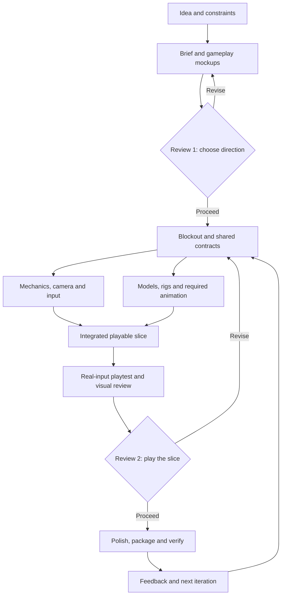

# Collaborative idea-to-game pipeline

Portable workflow for turning a small game idea into a coherent, editable,
playable browser prototype. This document describes responsibilities, review
points, and evidence boundaries. It is a workflow reference, not a runnable
orchestration system.

## 1. First delivery

Aim for one complete level or round, solo or with bots as appropriate, with
desktop and touch controls when they fit the game. A handoff should include:

- a local build with launch instructions;
- editable source, authoring files, generation scripts, and asset provenance;
- one start → play → win/lose → replay flow;
- onboarding, game UI, feedback, sound, and a clear prototype label;
- actual gameplay captures, verification results, and known limitations;
- a packaged playtest candidate, plus hosted verification when deployment is
  authorized and tested. Reuse existing authorization rather than asking again.

Large campaigns, monetization, real-time online multiplayer, and a general
purpose editor are later concerns unless the brief explicitly requires them.

## 2. Working loop

Reopen affected decisions when a control, camera, or interaction change
invalidates a dependent asset or test. Preserve unaffected verified work.

## 3. Review points

### Review 1 — choose the direction

Present a short brief and a few distinct gameplay mockups. Each should show
the player, goal, obstacle, controls, and intended screen shape. Record the
selected direction and unresolved questions. Routine file organization and
implementation choices remain with the agent.

### Review 2 — play the first complete slice

Provide a runnable build, a short recording or capture from actual gameplay,
and an assessment against the brief. The reviewer decides whether the central
interaction merits further development and identifies the highest-value fixes.
Repair the core slice before expanding content when its mechanic is unclear.
The `slice` step ([template](../prompt-templates/4-slice.md)) builds this
round, writes `docs/direction/review-2.md` with the top 3 fixes ranked, and
stops there until the reviewer picks.

Between reviews, reversible implementation work can continue. Escalate a
change to the accepted premise, an unresolved creative choice after bounded
attempts, or a cost/scope limit. Host and platform product behavior is part of
the premise: when a public lobby is created, whether play pauses while online,
what a player sees before choosing a mode. Ask before changing it; one game
created public lobbies at boot and reverted that a release later. Waiting for
feedback is an explicit state; silence does not choose a direction.

### Front-end flow

Agree the path from page load to play once, as a storyboard, before restyling
any part of it: boot → ready → press (the audio unlock) → menu → play. For each
step, write down what is visible, what moves and what each press does. Record
each reversal in the decision log as a decision or a veto, and add no motion
(slides, glides, swoops, see-through wipes) the user did not ask for. In one
game about seven splash and menu sessions in one day reversed two decisions
twice: whether the menu showed behind the loading screen, and a see-through
start wipe.

## 4. Stages and gates

| Stage | Output | Gate to continue |
| --- | --- | --- |
| Shape | Brief: fantasy, decisions, loop, win/lose, session, devices, scope, fun hypothesis | Goal, action, consequence, and assumptions are clear |
| Explore | Mockups, selected direction, palette, camera, UI composition | Direction is reviewed and readable at target sizes |
| Prove | Blockout with movement, interaction, collision, failure, recovery; a floor plan in metres before a bigger world | Real input exercises a proxy loop and major risks are known |
| Produce | Reusable sources, exports, rigs/clips, audio provenance | One representative asset exports, reimports, and loads in the game |
| Integrate | Complete round/level with representative assets and menu/results flow | Real input completes and replays it; state, animation, collision, and presentation agree |
| Improve | Balance, teaching, detail, transitions, effects, audio | Targeted regressions and separate desktop/touch visual review pass |
| Package | Versioned build, screenshots, optional teaser, analytics questions | Package and included assets are checked against a recorded build revision |

Design camera, controls, and UI space during mockup and blockout. Add final
styling later. Keep a small mechanics blockout available for regression when it
helps iteration. If telemetry is in scope, establish the boot-to-play measurement
with the first playable ([recipe](analytics.md)) and extend it with the features
players can reach. Failed loads and short play sessions need separate diagnoses.

## 5. Responsibilities and shared agreements

Use one coordinator and add workers only when file ownership is clear:

- **Coordinator:** scope, decisions, integration, stage status, handoff.
- **Art/animation:** references, Blender sources, exports, visual checks.
- **Gameplay:** simulation, input, camera, blockout, core-loop behavior.
- **Reviewer:** inspect the actual build against the brief and report reproducible defects.
- **Capture/commit:** record decisions and evidence and make serialized local commits when the project requires it.

Before parallel work, agree on asset IDs, units, axes, pivots, collider sizes,
sockets, clip names, and gameplay events. One system owns each piece of game
state; rendering and animation consume that state.

## 6. Evidence and repair

Evaluate two independent questions:

1. **Does it work?** Use real input to load assets and exercise success,
   failure, pause, replay, and affected transitions.
2. **Does it communicate?** Compare actual gameplay frames with the selected
   direction. Inspect silhouettes, camera framing, prompts, lighting, audio,
   UI motion, and desktop/touch composition.

Every repair records the problem, changed boundary, and evidence of improvement.
Functional checks do not establish readability or enjoyment. Emulated touch
does not establish physical-phone performance.

A visual task is not done until it passes the comparison gate: mockup and
runtime frames side by side at matched cameras, plus an explicit list of the
gaps that remain ([procedure](verification-and-delivery.md#visual-comparison)).
Agents tend to report a look as finished after a parameter pass. In one game
the user rejected "done" visual work about a dozen times, while a saved
dev-tuning override had silently replaced the lighting. Develop a look change
on an A/B worktree served on a second dev port, and hand over a side-by-side or
slider capture rather than a description.

When the user reports a regression, add a guard with the fix where feasible: a
unit test, a smoke assertion, or an asset-verification check. A fix without a
guard does not stay fixed. One game removed the same rejected treatment four
times, and it came back four times.

Set a bounded repair policy and budget before paid generation or long runs.
Keep the last working build and report partial success honestly when tools fail.

## 7. Resumable project records

Keep the project, rather than chat memory, as the source of truth. A future
runner may persist these proposed records:

| Record | Purpose |
| --- | --- |
| Brief and decision log | Accepted premise, scope, choices, vetoes, open questions |
| Direction pack | Selected mockups, style rules, references |
| Asset/game contracts | Stable IDs, dimensions, exports, clips, shared data |
| Run state | Stage, owners, revisions, outputs, budget, pending feedback |
| Review record | Captures, checks, defects, fixes, limitations |
| Build receipt | Source revision, asset hashes, local and hosted verification status |

These records are a proposed structure, not an implemented schema. Reuse
verified work, detect changed inputs, and retry uploads only after checking an
existing receipt.

Keep **vetoes** in the decision log: each treatment the user rejected, with the
date, their words and the guard that enforces it (for example "no ground ring
under characters"; "no camera FOV punch on melee"). Check the list before
proposing or adding a treatment, and again when restoring files from an older
commit or branch, which brings back whatever was removed after it. Remove a veto
only when the user lifts it.

## 8. Portable references

- [Asset contract template](templates/asset-contract.md)
- [Vertical-slice contract template](templates/vertical-slice-contract.md)
- [Verification and delivery checklist](verification-and-delivery.md)
- [Game UI design reference](../.agents/skills/blender-wasm-webgpu/references/game-ui-design.md)
- [Blender/WebGPU skill](../.agents/skills/blender-wasm-webgpu/SKILL.md)
- [Blender headless skill](../.agents/skills/blender-headless/SKILL.md)
- [Wavedash skill](../.agents/skills/wavedash/SKILL.md) when its hosting workflow applies

Use only the sections relevant to the current game. A playable starter runtime
is included ([starter](starter.md)); an automated runner that executes this
workflow is not.
