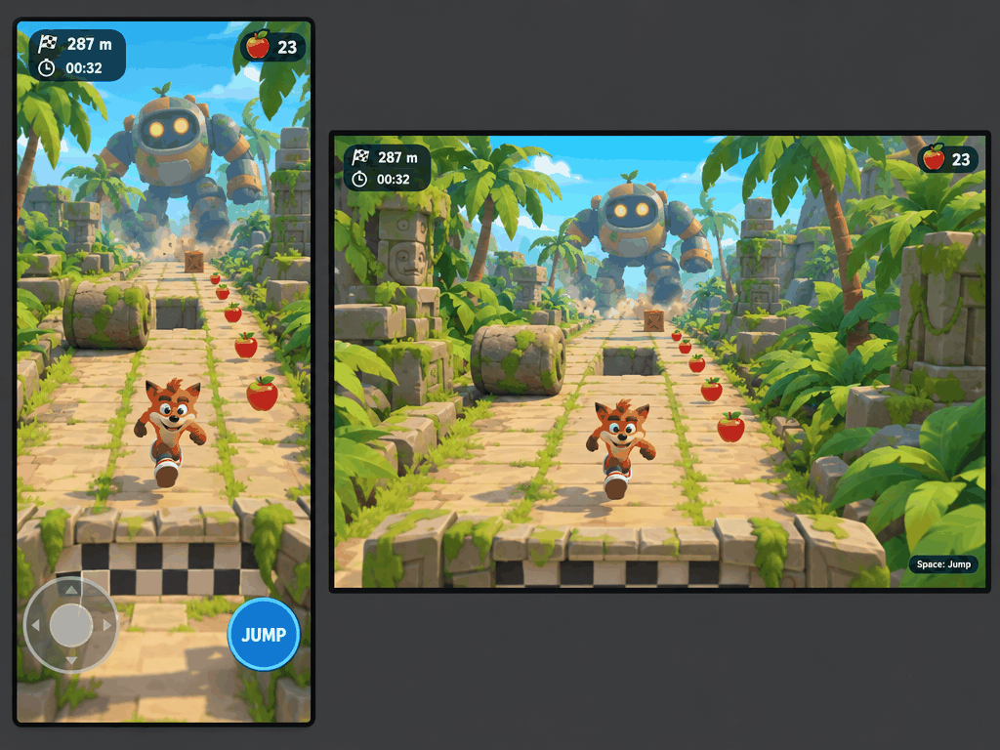
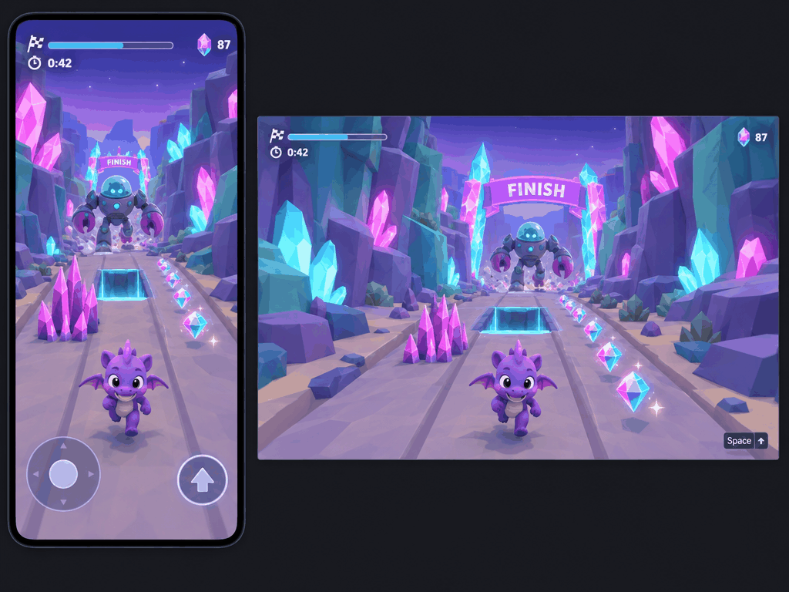
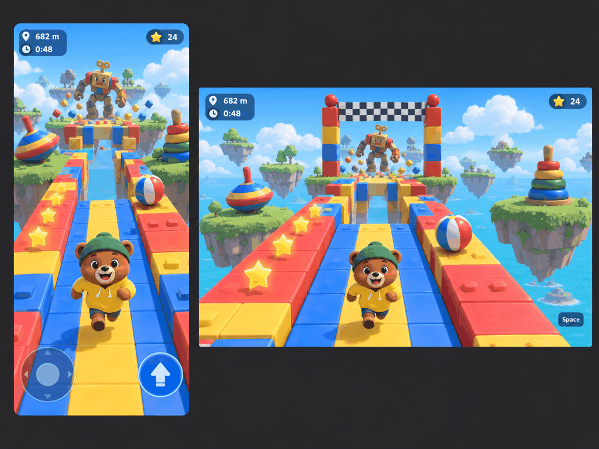
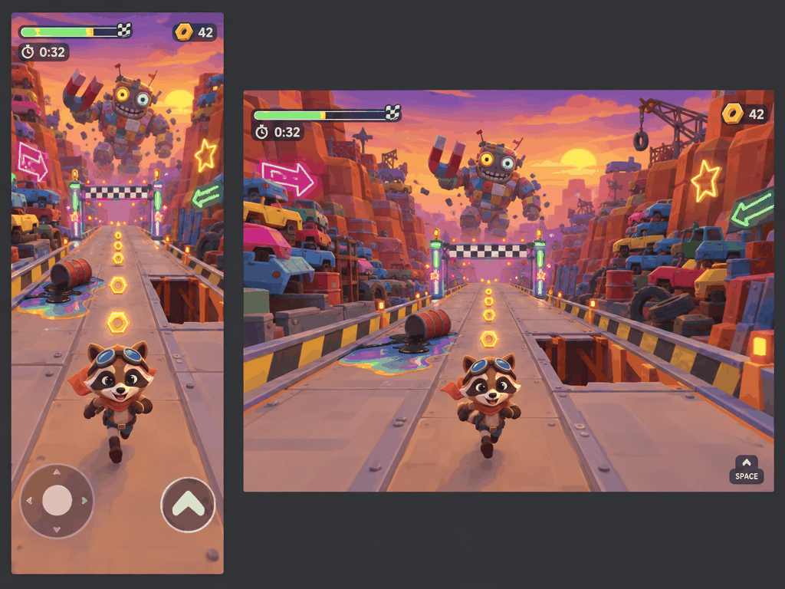

# Review 1 — Mockups (blank-start)

**Brief reminder:** an oncoming Crash × Mario 3D × Spyro runner. You sprint toward the camera, dodge between lanes, jump and collect while a mech chases you in the background. You win by finishing the course and lose by hitting a hazard, falling, or getting caught. Each round lasts 45–90 s. Solo, desktop + mobile, whimsical and family-friendly.

**What varies:** setting only. Camera, gameplay moment, HUD layout and hero size stay the same.

## Assumptions (usual answers — correct me if wrong)

- **Count:** 4
- **Screen shapes:** one composite image per option, with a portrait phone frame and a widescreen desktop frame of the same scene
- **Target asset style:** low-poly, flat colour, toon-shaded, with readable silhouettes (within reach of the Blender → GLB pipeline)
- **Avoid:** gore, horror, sexual content, courier/delivery themes
- **Model:** GPT Image 2.5 Flare on fal (`gpt-image-2.5-flare-t2i`, endpoint `openai/gpt-image-2.5/flare/text-to-image`), quality `high`, `landscape_4_3` (1024×768)

Prompts were written separately for each option, and each one is saved next to its image (`share/media/review-1/prompt-X.txt`). Raw outputs and manifests are in the ignored `out/mockups/review-1/run-X/`. The fal ledger is `experiments/fal-image/ledger.jsonl`.

These are mood and direction images only. **Do not read world size from them.** The slice step sizes the course from a floor plan in metres.

---

## A — Tropical jungle ruins (Crash vibe)

- **Player does:** an orange fox-critter sprints down a three-lane mossy stone path toward the camera. A stone log blocks the left lane, apples line the centre and right, and a gap lies ahead. A big round-headed mech stomps through palms far behind.
- **Reads well:** this one has the clearest chase. The mech is centred and framed by the path. The checkered finish strip sits in the foreground, the only option where the goal is ahead of the player. The apples and HUD are very legible, and the desktop frame shows only a "Space: Jump" hint.
- **Biggest risk:** the hero looks a lot like Crash Bandicoot (IP lookalike), so it needs a redesign in kickoff. The jungle also has the most foliage to build and keep uncluttered.
- **Asset-tool reachability:** good. Stone blocks, logs, crates and apples are simple low-poly shapes. Palms and ferns need card/low-poly foliage, which is reachable but adds the most work of the four.
- **Prompt:** `share/media/review-1/prompt-A.txt` (raw: `out/mockups/review-1/prompt-A.txt`)
- **Model / request / cost:** gpt-image-2.5-flare-t2i · `01a1a204-72eb-7230-8852-7a71f6464564` · **$0.0385**

## B — Crystal canyon / gem caves (Spyro vibe)

- **Player does:** a purple baby dragon runs toward the camera on a pale canyon track. Pink crystal spikes block the left lane, a glowing gap sits ahead, and a line of gems runs on the right. A dome-headed claw mech strides behind.
- **Reads well:** the palette is the most cohesive (purple/teal with pink and cyan accents). The gems are excellent collectible reads, and the hazards contrast clearly with the track. The HUD is minimal with a progress bar.
- **Biggest risk:** the "FINISH" arch is drawn behind the player, next to the mech, so the image suggests running away from the goal. The hero is also close to Spyro. With a mostly purple palette, the hero can blend into the rocks.
- **Asset-tool reachability:** very good. Faceted crystals and rocks are natural low-poly, and emissive crystal materials are cheap.
- **Prompt:** `share/media/review-1/prompt-B.txt`
- **Model / request / cost:** gpt-image-2.5-flare-t2i · `01a1a204-efa5-7512-ae1c-d757f9c3df39` · **$0.0383**

## C — Sunny floating islands / toybox (Mario 3D vibe)

- **Player does:** a bear cub in a green beanie and yellow hoodie runs down a red/yellow/blue toy-block track over the sea. A striped beach ball rolls in the right lane, stars line the left, and a gap sits between platforms. A wooden wind-up toy robot clanks along behind.
- **Reads well:** the lanes are the most readable (colour-blocked). The hero is original. The mech is goofy and family-friendly, and the bright sky gives the strongest silhouette separation.
- **Biggest risk:** the checkered finish gate is behind the player on desktop, as in B and D. The block track can look busy, since every lane is multicoloured, and the beach ball blends a little into the track colours. The floating islands invite "make the world bigger" scope creep.
- **Asset-tool reachability:** best of the four. Toy blocks, tops, ring stacks, balls and stars are primitive-based flat-colour meshes, and the wind-up robot is boxy.
- **Prompt:** `share/media/review-1/prompt-C.txt` (v1 of this prompt was rejected by fal's content checker, probably because the hero read as Mario. The rejected prompt is kept at `out/mockups/review-1/prompt-C-v1-flagged.txt`, request `01a1a205-68f8-7a53-b45b-6e1ae85953be`, with no image and no billable units recorded.)
- **Model / request / cost:** gpt-image-2.5-flare-t2i · `01a1a206-bd7f-7e10-bea4-453254b5649a` · **$0.0384**

## D — Scrapyard canyon with neon signs (mech's backyard)

- **Player does:** a raccoon with goggles and a red scarf runs down a riveted metal walkway. An oil slick and tipped barrel take the left lane, and a broken gap is open on the right. Hex-nut bolts line the centre, and a patchwork junk mech with a magnet arm looms in a sunset sky.
- **Reads well:** this one has the most personality and the best story link (you're in the mech's yard). The neon arrows and stars add accent and wayfinding without text, and the sunset backlights the mech nicely.
- **Biggest risk:** busiest scene. The stacked cars and neon signs crowd the sides, and the hero is brownish against a brownish track (lower contrast). The finish gate is behind the player.
- **Asset-tool reachability:** good but heavier. Many distinct junk props (cars, tyres, crane) mean more models, though each is simple low-poly. Neon needs emissive materials, plus bloom if wanted.
- **Prompt:** `share/media/review-1/prompt-D.txt`
- **Model / request / cost:** gpt-image-2.5-flare-t2i · `01a1a205-d760-7870-b8e3-53a699d78ca8` · **$0.0385**

---

## Comparison

| | A Jungle ruins | B Crystal canyon | C Toybox islands | D Scrapyard neon |
| --- | --- | --- | --- | --- |
| Chase reads (mech behind, player fleeing) | Strong | Good | Good | Strong |
| Lane / hazard readability | Good | Good | Very good | Fair (busy sides) |
| Hero vs background contrast | Good | Fair (purple on purple) | Very good | Fair (brown on brown) |
| Collectible read | Apples, clear | Gems, excellent | Stars, clear | Bolts, clear |
| Goal placement in frame | Ahead (foreground) | Behind player | Behind player (desktop) | Behind player |
| IP-lookalike risk | High (Crash-like hero) | Medium (Spyro-like) | Low | Low |
| Asset effort (Blender low-poly) | Medium-high (foliage) | Low | Lowest | Medium-high (many props) |
| Touch controls only in phone frame | Yes | Yes | Yes | Yes |
| Cost | $0.0385 | $0.0383 | $0.0384 | $0.0385 |

**Total spend:** about **$0.154** (4 billed images, reconciled from fal billable-units headers). The first, content-flagged attempt at C shows no billable units.

**Note on the goal:** in an oncoming camera the finish line is ahead of the player, which means behind the camera. B, C and D drew the gate behind the runner instead. In the game, the HUD progress bar carries the goal, and the gate appears in the foreground only near the end. This doesn't change the art-direction choice.

**My pick (one line):** C. It has the most readable lanes and silhouettes, an original family-friendly hero, and the cheapest look for our low-poly pipeline to actually match. B's crystal palette would be my runner-up.

## Decision

**Owner pick (2026-11-03 Asia/Hong_Kong): D — Scrapyard neon.**

Direction: scrapyard canyon with neon signs; raccoon hero (goggles + red scarf); hex-nut collectibles; oil slick / barrel / gap hazards; patchwork junk mech with magnet arm; sunset backlight; low-poly flat colour.

Vetoes / notes carried into kickoff:
- Keep hero original (no IP lookalikes).
- Raise hero/track contrast (D’s brown-on-brown risk).
- Finish gate belongs ahead of the player (foreground near end); HUD progress carries the goal earlier.
- Simplify busy sides vs the mockup so lanes stay readable.
